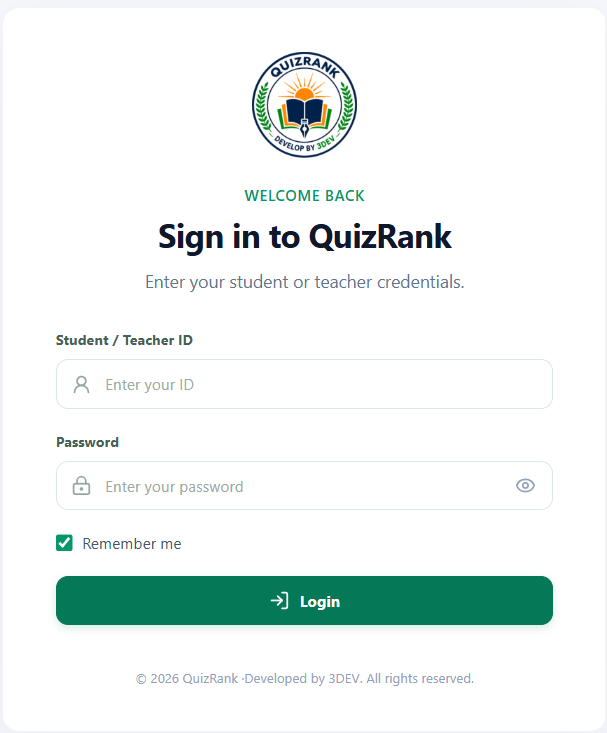
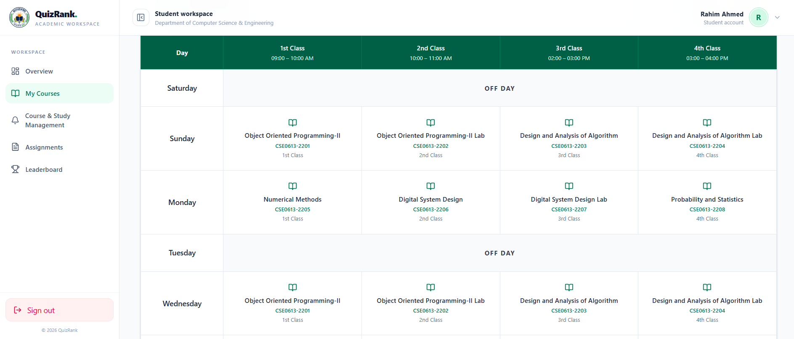
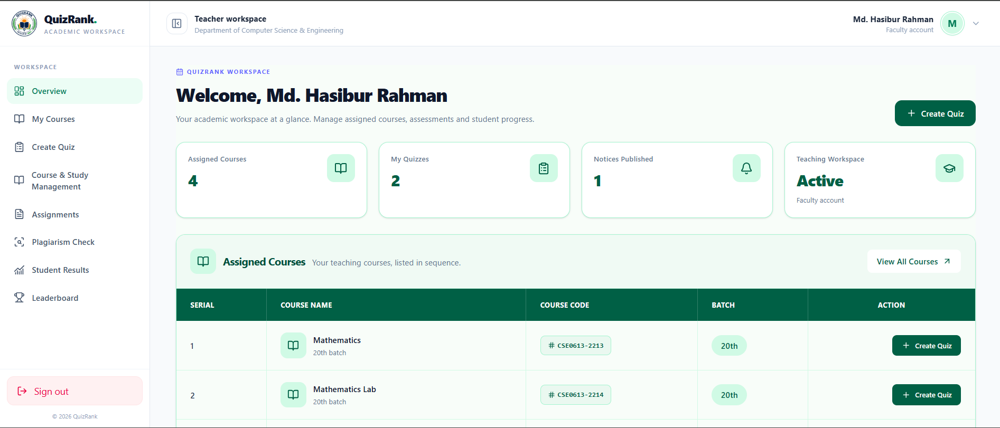
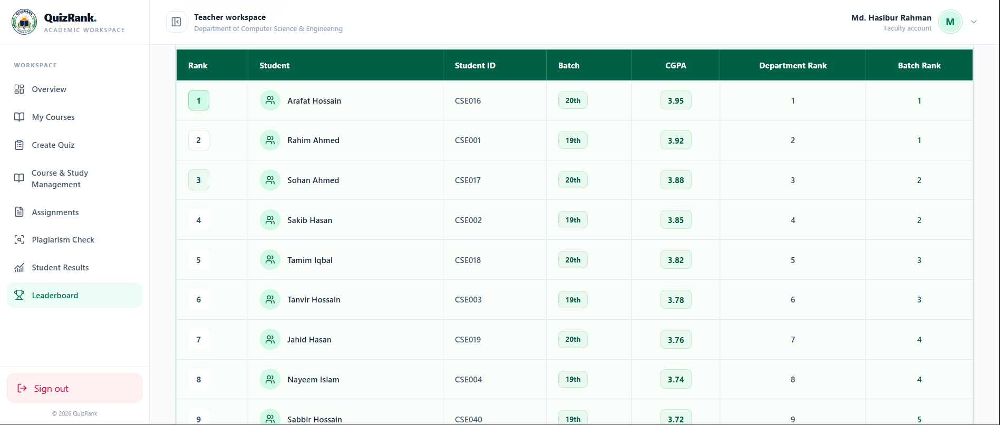

#  QuizRank – Online Quiz & Ranking System

**QuizRank** is a web-based Online Quiz and Academic Ranking System designed to help students participate in online quizzes, track their academic performance, and monitor their rankings. Teachers can manage quizzes, publish notices, and evaluate student performance through a dedicated dashboard.

The platform provides separate interfaces for **Students** and **Teachers**, with a centralized MySQL database.


##  Project Screenshots

###  Login Page


###  Student Dashboard


###  Teacher Dashboard


###  My Courses


###  Leaderboard



---

##  Live Demo

- ## Live Link : https://quiz-management-system-kappa.vercel.app/
- **GitHub Repository:** [https://github.com/ROKON-099/Quiz-management-system]
- Student ID:CSE[001-002,003,004,005.........]
- Pass: 123456;
- Teacher ID :T001-004;
- Pass:123456
  

---

##  Key Features

###  Student Panel
- Student registration and login.
- Personalized student dashboard.
- View personal profile and academic information.
- View current and previous semester CGPA.
- View batch ranking and department ranking.
- Browse assigned courses.
- Participate in online MCQ quizzes.
- View quiz results and performance.
- View available notices and announcements.
- Track academic progress.

###  Teacher Panel
- Secure teacher login.
- Personalized teacher dashboard.
- View assigned courses.
- Create and publish quizzes.
- Add multiple-choice questions (MCQ).
- Set quiz duration and correct answers.
- Manage quizzes.
- View student quiz performance.
- Publish and manage notices.
- Monitor assessment activities.

###  Ranking & Academic System
- Batch-wise student ranking.
- Department-wise student ranking.
- CGPA-based academic overview.
- Quiz performance tracking.
- Leaderboard system.

---

## 🛠️ Technology Stack

| Category | Technology |
|---|---|
| Frontend | React.js |
| Build Tool | Vite |
| Styling | Tailwind CSS |
| Icons | Lucide React |
| Backend | Java Spring Boot |
| Programming Language | Java |
| Database | MySQL |
| API Communication | REST API |
| HTTP Client | Axios |
| Routing | React Router |
| Backend ORM | Spring Data JPA / Hibernate |
| Development IDE | Visual Studio Code / IntelliJ IDEA |
| API Testing | Postman |
| Version Control | Git & GitHub |

---

##  Languages & Versions

| Technology | Version |
|---|---|
| Java | JDK 21 |
| JavaScript | ES6+ |
| React | Check `package.json` |
| Vite | Check `package.json` |
| Spring Boot | Check `pom.xml` |
| MySQL | Existing MySQL database version |
| Node.js | Required for frontend development |

> **Note:** Update the React, Vite, Spring Boot, and MySQL versions according to the versions used in the project configuration files.

---

##  Dependencies

### Frontend Dependencies

| Package | Purpose |
|---|---|
| `react` | Frontend UI development |
| `react-dom` | React DOM rendering |
| `react-router-dom` | Client-side routing |
| `axios` | HTTP requests to backend APIs |
| `lucide-react` | UI icons |
| `@tanstack/react-query` | Server-state management, if used |
| `tailwindcss` | Utility-first CSS framework |
| `vite` | Frontend development and build tool |

### Backend Dependencies

| Dependency | Purpose |
|---|---|
| `spring-boot-starter-web` | REST API development |
| `spring-boot-starter-data-jpa` | Database operations |
| `mysql-connector-j` | MySQL database connectivity |
| `spring-boot-starter-validation` | Request validation |
| `spring-boot-starter-security` | Authentication and authorization, if configured |
| `spring-boot-devtools` | Development support |
| `lombok` | Reduces boilerplate Java code, if used |

> The dependency lists above describe the expected stack. Confirm the exact installed packages from `package.json` and `pom.xml`.

---

##  Project Structure

```text
QuizRank/
│
├── frontend/
│   ├── public/
│   ├── src/
│   │   ├── assets/
│   │   ├── components/
│   │   ├── layouts/
│   │   ├── pages/
│   │   │   ├── student/
│   │   │   └── teacher/
│   │   ├── services/
│   │   ├── hooks/
│   │   ├── context/
│   │   ├── utils/
│   │   ├── App.jsx
│   │   └── main.jsx
│   ├── package.json
│   └── vite.config.js
│
├── backend/
│   ├── src/
│   │   ├── main/
│   │   │   ├── java/
│   │   │   │   └── com/quizrank/backend/
│   │   │   │       ├── config/
│   │   │   │       ├── controller/
│   │   │   │       ├── service/
│   │   │   │       ├── repository/
│   │   │   │       ├── entity/
│   │   │   │       ├── dto/
│   │   │   │       └── QuizRankApplication.java
│   │   │   └── resources/
│   │   │       └── application.properties
│   │   └── test/
│   └── pom.xml
│
└── README.md
```

---

##  Installation & Setup

### Prerequisites

Make sure you have installed:

- Java JDK 21/26
- Node.js and npm
- MySQL Server
- Visual Studio Code or IntelliJ IDEA
- Git

### 1. Clone the Repository

```bash
git clone YOUR_REPOSITORY_URL
```

```bash
cd QuizRank
```

### 2. Backend Setup

Navigate to the backend directory:

```bash
cd backend
```

Configure your MySQL connection in:

`src/main/resources/application.properties`

Example:

```properties
spring.application.name=quizrank

spring.datasource.url=jdbc:mysql://localhost:3306/quizrank
spring.datasource.username=root
spring.datasource.password=YOUR_MYSQL_PASSWORD

spring.datasource.driver-class-name=com.mysql.cj.jdbc.Driver

spring.jpa.hibernate.ddl-auto=none
spring.jpa.show-sql=true

server.port=8080
```

**Important:** QuizRank uses an existing MySQL database. Import or retain the existing database and its data before starting the backend. Do not create a new database unnecessarily.

Run the Spring Boot application:

```bash
mvn spring-boot:run
```

Backend API:

```text
http://localhost:8080
```

### 3. Frontend Setup

Open another terminal and navigate to the frontend directory:

```bash
cd frontend
```

Install dependencies:

```bash
npm install
```

Start the development server:

```bash
npm run dev
```

Frontend:

```text
http://localhost:5173
```

---

##  Application Architecture

```text
        Student / Teacher
                |
                v
         React Frontend
          (Vite + JSX)
                |
                v
          Axios Requests
                |
                v
       Spring Boot REST API
                |
                v
        Service Layer
                |
                v
      Repository Layer (JPA)
                |
                v
          MySQL Database
```

---

##  User Roles

QuizRank supports two user roles:

| Role | Access |
|---|---|
| Student | Student Dashboard, Courses, Quizzes, Results, Profile, Ranking and Notices |
| Teacher | Teacher Dashboard, Assigned Courses, Quiz Management and Notice Management |

There is no separate Admin panel.

---

##  UI Design

QuizRank uses a clean and responsive interface with a consistent green-based color scheme.

| Element | Color |
|---|---|
| Primary Green | `#006045` |
| Light Green | `#D0FAE5` |
| Page Background | `#F8FDF9` |
| Section Background | `#F0FAF4` |
| Card Background | `#FFFFFF` |

The interface is designed to work on desktop, tablet, and mobile devices.

---

##  Future Improvements

- Advanced quiz analytics.
- More detailed academic performance reports.
- Improved quiz scheduling.
- Exportable student performance reports.
- Enhanced authentication and security.
- Additional leaderboard statistics.

---

##  Developer

**Developed as an academic project.**

- **Project Name:** QuizRank
- **Category:** Online Quiz & Ranking System
- **Frontend:** React.js
- **Backend:** Java Spring Boot
- **Database:** MySQL

---

##  License

This project is developed for educational and academic purposes.
